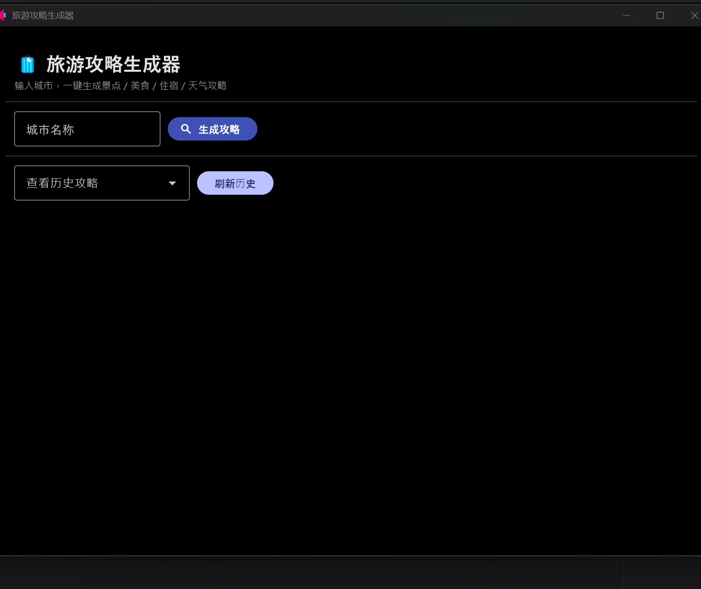

# 旅游攻略生成器（桌面版）

用 Python + [Flet](https://flet.dev) 做的桌面小程序：输入城市名，一键生成
**景点 / 美食 / 住宿 / 天气** 攻略，自带**序号标注地图**和**历史记录**。

> 适合想快速做一份城市出游清单、又懒得一个个查的人。


（截图占位：跑到程序界面后，截一张图命名 `screenshot.png` 放进本仓库即可显示在这里）

---

## ✨ 功能

- 🗺️ **高德 POI 拉取**：自动抓城市的景点、美食、住宿三类地点
- 🌤️ **天气预告**：调用 open-meteo 拉未来几天天气，**无需 Key**
- 🖼️ **自绘标注地图**：用 PIL 自己画一张带序号的圆点地图，点序号对应攻略条目
- 📒 **历史记录**：每次生成的攻略存成 JSON，可回看

---

## 🚀 快速开始

```bash
# 1. 克隆仓库
git clone https://github.com/xBoo-78/travel_guide.git
cd travel_guide

# 2. 安装依赖
pip install -r requirements.txt

# 3. 配置高德 Key（见下方说明），把 .env.example 复制为 .env 后填入
cp .env.example .env
#   然后用记事本打开 .env，把 AMAP_KEY= 后面换成你自己的 Key

# 4. 启动
python travel_guide.py
```

程序会弹出一个桌面窗口，输入城市名即可生成攻略。

---

## 🔑 如何申请高德地图 Key（免费）

1. 打开 [高德开放平台](https://lbs.amap.com/) → 右上角**注册 / 登录**（用支付宝或手机号都行）
2. 进入**控制台** → 左侧 **应用管理 → 我的应用**
3. 点 **创建应用**，随便起个名字（如 `travel_guide`），类型选「其他」
4. 在应用下点 **添加 Key**：
   - **服务平台**：选 **Web 服务**（⚠️ 不是 Web 端，也不是 Android/iOS）
   - 提交后会得到一串 32 位的 Key
5. 把它填进你的 `.env`：`AMAP_KEY=你刚申请的Key`

> 每天有调用额度限制（个人开发者够用）。Key 只属于你，**不要提交到任何公开仓库**。

---

## 📁 项目结构

```
travel_guide/
├── travel_guide.py     # 主程序（四大类：POIService / WeatherService / TravelGuide / GuideApp）
├── .env.example        # Key 模板（不含真实 Key，可提交）
├── .env                # 你的真实 Key（被 .gitignore 忽略，绝不入库）
├── .gitignore          # 屏蔽 .env 与运行时产物
├── requirements.txt    # 依赖：flet / requests / pillow / python-dotenv
├── README.md           # 你正在看的这份
├── guides/             # 运行时自动生成，存放每次攻略的 JSON
└── usage.json          # 运行时自动生成，使用统计
```

---

## 📝 说明

- **高德 Key** 需自行申请并放入 `.env`，受 `.gitignore` 保护，不会进入版本库。
- **天气数据**来自 [open-meteo](https://open-meteo.com/)，完全免费且无需 Key。
- 如果你只想在浏览器里跑（而不是弹窗桌面程序），把 `travel_guide.py` 末尾的
  `ft.run(main)` 改成 `ft.run(main, view=ft.AppView.WEB_BROWSER)` 即可。

---

## 📄 License

[MIT](LICENSE)
